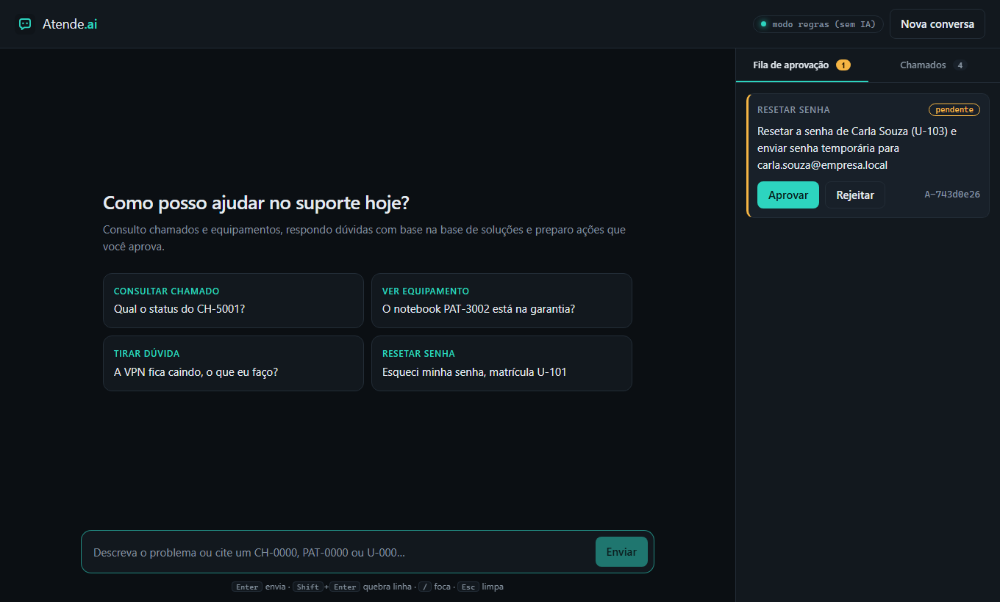
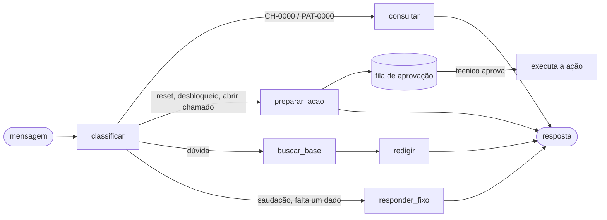

# Atende.ai

Agente de IA para **help desk de TI**. Ele conversa com quem precisa de suporte, consulta chamados e equipamentos, responde dúvidas com base numa base de soluções e **prepara ações**, como abrir chamado, resetar senha e desbloquear conta. Essas ações só acontecem depois que um técnico aprova.



## O que ele faz

| Você escreve | O agente |
|---|---|
| "Qual o status do CH-5001?" | Consulta o chamado no banco e responde com situação, técnico e prioridade |
| "O notebook PAT-3002 está na garantia?" | Consulta o equipamento pelo número de patrimônio |
| "A VPN fica caindo, o que eu faço?" | Busca na base de soluções e responde citando o artigo, como `KB-01` |
| "Esqueci minha senha, matrícula U-101" | **Prepara** o reset de senha e coloca na fila de aprovação |
| "Abra um chamado urgente, o sistema caiu" | **Prepara** um chamado com prioridade alta |
| "Esqueci minha senha" (sem matrícula) | Pergunta a matrícula em vez de chutar |
| "Qual a capital da França?" | Avisa que só ajuda com TI, sem gastar chamada de IA |

## Como funciona

O agente é um grafo do **LangGraph**. Cada mensagem passa pelos nós abaixo:



Decisões de projeto:

- **Classificar por regras, não por IA.** Um modelo pequeno confunde "qual o status do chamado" com "abra um chamado". As regras são testadas e não erram nesses casos.
- **Consultas usam texto montado do banco.** A IA nunca escreve o status de um chamado, então não tem como inventar um.
- **A IA só escreve no nó `redigir`**, com base nos artigos encontrados. Se ela citar um artigo que não recebeu (por exemplo `[KB-99]`), a resposta é descartada e entra o texto pronto.
- **Ações em dois passos.** `preparar` grava a ação como pendente. `executar` só roda pela rota de aprovação. O agente não alcança o `executar`.
- **Se a IA falhar**, o sistema tenta de novo com espera crescente e depois usa o texto pronto. O usuário sempre recebe resposta.
- **Busca BM25** na base de soluções: rápida, sem modelo, sem internet e com resultado repetível. Tem cache.

## Tecnologias

| Parte | Tecnologia |
|---|---|
| Agente | LangGraph 1.2 |
| API | FastAPI 0.162, Python 3.13, uv |
| Banco | SQLite com SQLAlchemy 2.1 |
| IA | Ollama (local, grátis) ou Claude (API da Anthropic) |
| Tela | React 19, TypeScript 7, Vite 8 |
| Testes | pytest (56 testes) e CI no GitHub Actions |

## Como usar no Windows

### Requisitos

- [uv](https://docs.astral.sh/uv/) (instala o Python sozinho)
- [Node.js](https://nodejs.org) 22 ou mais novo
- [Ollama](https://ollama.com), se quiser IA local

### Ligar

```powershell
git clone https://github.com/Phb29/atende-ai.git
cd atende-ai
ollama pull qwen2.5:3b      # só se for usar o Ollama
.\iniciar.ps1
```

Na primeira vez o script gera a tela. Depois ele abre o navegador em http://127.0.0.1:8000. Para desligar, feche a janela ou aperte `Ctrl+C`.

Para trocar o provedor de IA:

```powershell
.\iniciar.ps1                       # Ollama (padrão)
.\iniciar.ps1 -Provedor regras      # sem IA, só regras e textos prontos
.\iniciar.ps1 -Provedor anthropic   # Claude: pede a chave na hora e não salva em arquivo
```

> Se o Ollama der erro 500, normalmente é a placa de vídeo. O `iniciar.ps1` já liga com `OLLAMA_NUM_GPU=0`, que roda só no processador.

### Usar a tela

- Clique numa sugestão ou escreva. Para dar contexto, use os códigos `CH-0000` (chamado), `PAT-0000` (patrimônio) e `U-000` (matrícula).
- As ações preparadas aparecem dentro da conversa e na **Fila de aprovação**, à direita, com os botões **Aprovar** e **Rejeitar**.
- Na aba **Chamados**, clique num chamado para perguntar o status dele ao agente.
- Em cada resposta, **ver caminho do agente** mostra por quais nós do grafo a mensagem passou e qual provedor respondeu.
- Atalhos: `Enter` envia, `Shift+Enter` quebra linha, `/` foca a caixa de texto, `Esc` limpa. **Parar** cancela uma resposta em andamento.
- A conversa fica salva no navegador. **Nova conversa** limpa tudo.

### Dados de exemplo

O banco já vem com:

| Tipo | Códigos |
|---|---|
| Usuários | `U-101` Ana, `U-102` Bruno (conta bloqueada), `U-103` Carla, `U-104` Diego |
| Equipamentos | `PAT-3001` a `PAT-3005` |
| Chamados | `CH-5001` a `CH-5004` |
| Artigos | `KB-01` a `KB-08` (VPN, senhas, impressora, e-mail, lentidão, software, Wi-Fi, garantia) |

Para recomeçar do zero, apague a pasta `backend/dados`.

### Desenvolvimento

```powershell
# backend com recarga automática
cd backend
uv run uvicorn app.main:app --reload --port 8000

# tela com recarga automática (em outro terminal), abre em http://localhost:5173
cd frontend
npm ci
npm run dev
```

### Testes

```powershell
cd backend
uv run pytest -q
```

Os testes cobrem a classificação das mensagens, a busca, a aprovação (nada é criado antes de aprovar, rejeitar não cria nada, aprovar duas vezes dá erro `409`), a API e o comportamento com a IA fora do ar ou inventando artigo.

### Docker

```powershell
docker build -t atende-ai .
docker run -p 8000:8000 atende-ai
```

Para usar o Ollama da sua máquina a partir do container, adicione `-e ATENDE_PROVEDOR=ollama -e OLLAMA_URL=http://host.docker.internal:11434`.

## Configuração

Todas as opções são variáveis de ambiente. O modelo está em [.env.example](.env.example).

| Variável | Padrão | O que é |
|---|---|---|
| `ATENDE_PROVEDOR` | `regras` | `regras`, `ollama` ou `anthropic` |
| `ATENDE_CHAVE_API` | `demo-key` | Chave do cabeçalho `X-API-Key` |
| `ATENDE_BANCO` | `sqlite:///./dados/atende.db` | Endereço do banco |
| `OLLAMA_MODELO` | `qwen2.5:3b` | Modelo do Ollama |
| `OLLAMA_NUM_GPU` | vazio | `0` roda só no processador |
| `ANTHROPIC_API_KEY` | vazio | Chave do Claude (nunca coloque no Git) |
| `ANTHROPIC_MODELO` | `claude-haiku-5-5` | Modelo do Claude |

## API

As rotas `/api` exigem o cabeçalho `X-API-Key`.

| Método | Rota | O que faz |
|---|---|---|
| POST | `/api/conversa` | Uma mensagem: `{resposta, intencao, passos, fontes, acao, provedor}` |
| POST | `/api/conversa/fluxo` | A mesma resposta em partes (SSE: `inicio`, `texto`, `fim`) |
| GET | `/api/chamados` | Lista os chamados |
| GET | `/api/chamados/{numero}` | Um chamado |
| GET | `/api/equipamentos/{patrimonio}` | Um equipamento |
| GET | `/api/base?q=` | Busca na base de soluções |
| GET | `/api/acoes?situacao=` | Ações (pendente, aprovada, rejeitada) |
| POST | `/api/acoes/{id}/aprovar` | Aprova e executa uma vez |
| POST | `/api/acoes/{id}/rejeitar` | Rejeita sem alterar nada |
| GET | `/saude` | Está no ar? (sem chave) |
| GET | `/pronto` | Provedor em uso e se a IA responde (sem chave) |

Todo erro vem no mesmo formato:

```json
{ "erro": { "codigo": "ACAO_JA_DECIDIDA", "mensagem": "A ação A-1f2e3d4c já foi aprovada.", "id_requisicao": "9c1b2a3d4e5f" } }
```

## Limitações

- A autenticação é uma chave única compartilhada, sem login por usuário nem perfil de técnico.
- O "streaming" divide em partes uma resposta já pronta. Ainda não transmite os pedaços enquanto o modelo escreve.
- A qualidade das respostas da IA não tem avaliação automática. Os testes verificam regras e proteções, não o texto que o modelo escreve.
- O reset de senha é simulado: nenhum e-mail é enviado.
